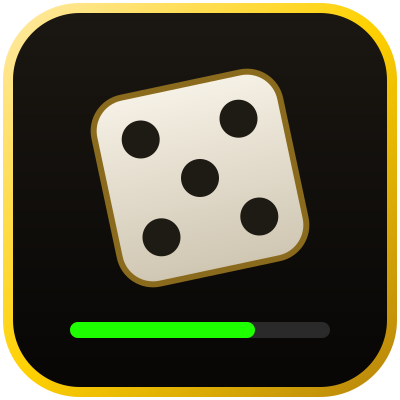

  

<h1 align="center">Auxy Loot</h1>

  Würfelfenster für Gruppen-Loot in <b>World of Warcraft: Forever</b>

  
  
  
  

Blizzards Würfelfenster ist groß und zeigt nicht, wer was gewählt hat. Auxy Loot ersetzt es durch eine schmale Leiste: Item, Restzeit und die vier Knöpfe. Darunter steht, was die anderen gewählt und gewürfelt haben, und am Ende, wer das Item bekommt.

## Funktionen

- **Geht von selbst auf**, sobald gewürfelt wird. Item-Symbol, Name in Qualitätsfarbe, Restzeit als Balken.
- **Bedarf, Gier, Entzaubern, Passen.** Was gerade nicht geht, ist ausgegraut, der Tooltip sagt warum.
- **Würfe der Gruppe:** Unter jedem Item steht, wer was gewählt und gewürfelt hat. Bedarf oben, höchster Wurf zuerst, der Gewinner wird markiert. Maus über die Zeile zeigt die ganze Liste.
- **Beute der Gruppe:** kleine Liste, wer die ausgewürfelten Items bekommen hat. Verschwindet nach ein paar Sekunden.
- **Lootfilter** pro Qualität: fragen, automatisch Gier oder automatisch passen. Bei gebundenen Items (BoP) wird immer gefragt. Ab Werk ist der Filter aus.
- **Beutefenster zu:** Liegen in der Leiche nur noch Items zum Würfeln, schließt Auxy Loot das Beutefenster. Sonst nimmt WoW keine Rechtsklicks in die Welt an. Das Würfeln läuft weiter.
- **Übersteht `/reload`:** laufende Würfe, die Wahl der anderen und die Beute-Liste sind danach wieder da.
- Größe, Breite und Richtung (wächst nach unten oder oben) lassen sich einstellen.

## Installation

**Mit Wago:** [addons.wago.io/addons/auxy-loot](https://addons.wago.io/addons/auxy-loot), dort kommen neue Versionen automatisch an.

**Von Hand:**

1. Unter [Releases](https://github.com/Auxilias/auxy-loot/releases/latest) die `AuxyLoot.zip` herunterladen.
2. Entpacken nach `World of Warcraft\_forever_\Interface\AddOns\`. Danach liegt dort der Ordner `AuxyLoot`.
3. WoW neu starten.

Für ein Update einfach den Ordner ersetzen, die Einstellungen bleiben erhalten.

## Bedienung

Zum Ausprobieren `/auxyloot test` eingeben. Das zeigt drei Beispiel-Würfe mit erfundenen Mitspielern, gewürfelt wird dabei nicht.

| Befehl | Was passiert |
|---|---|
| `/auxyloot test` | Beispiel-Würfe anzeigen |
| `/auxyloot menü` | Einstellungen öffnen |
| `/auxyloot oben` / `unten` | Fenster wächst nach oben oder unten |
| `/auxyloot groß 1.2` | Größe (0.6 bis 2) |
| `/auxyloot blizzard` | Blizzards Würfelfenster wieder ein- oder ausblenden |
| `/auxyloot reset` | Position zurücksetzen |

Verschieben über die goldene Titelzeile. Rechtsklick auf die Titelzeile oder eine Zeile öffnet die Einstellungen.

## Gut zu wissen

- Die Oberfläche ist auf Deutsch. Der Client darf jede Sprache haben, die Würfe der anderen liest Auxy Loot aus Blizzards Loot-Meldungen.
- Auxy Loot würfelt nur dann selbst, wenn du den Lootfilter dafür einstellst.
- Fehler oder Ideen gerne als [Issue](https://github.com/Auxilias/auxy-loot/issues). Bei Lua-Fehlern hilft der Text aus BugSack.

## Wie es entstanden ist

Auxy Loot ist ein Hobbyprojekt für meine Gruppe in WoW Forever. Der Code ist größtenteils mit KI geschrieben (Claude von Anthropic). Ideen, Tests im Spiel und die Entscheidung, was rein kommt, kommen von mir.

## Lizenz

MIT, siehe [LICENSE](https://github.com/Auxilias/auxy-loot/blob/main/LICENSE).

---

### English

A compact group-loot roll window for WoW: Forever. It opens on its own when a roll starts and has Need, Greed, Disenchant and Pass buttons. It also shows what everyone else picked and rolled, and who won. Optional loot filter per quality (never for bind-on-pickup items). Survives `/reload`. Type `/auxyloot test` for a demo. The UI is German only, but it works with any client language. Written largely with AI assistance (Claude), tested in game. MIT license.
